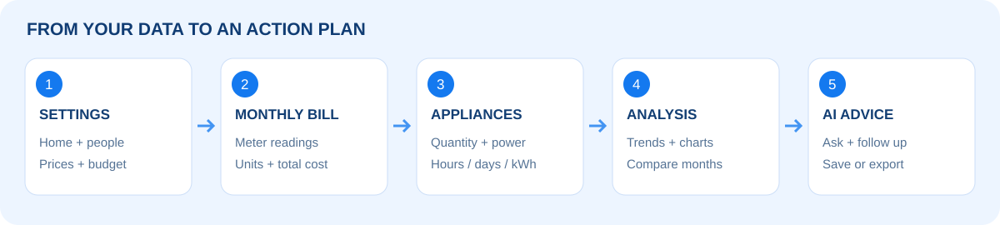
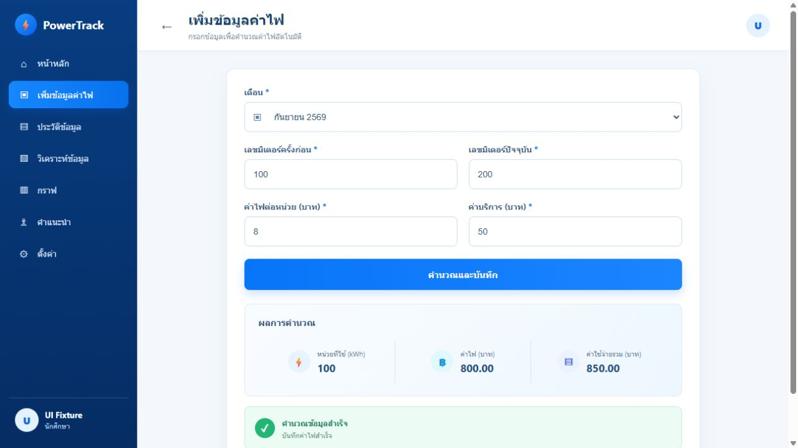
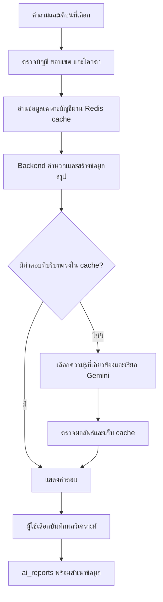
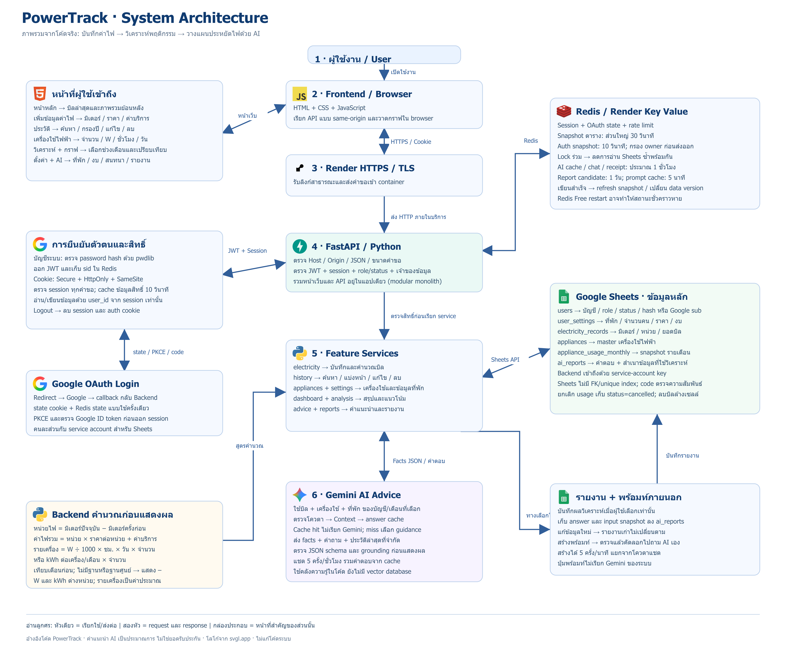
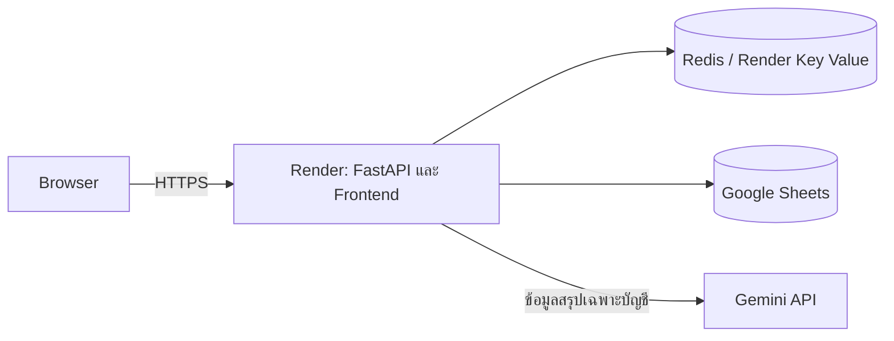

<div align="center">


# PowerTrack ⚡

**ระบบบันทึกค่าไฟ วิเคราะห์เครื่องใช้ไฟฟ้า และวางแผนประหยัดไฟด้วย AI**

มินิโปรเจกต์มหาวิทยาลัย · FastAPI · Google Sheets · Redis · Gemini · Render

[เปิดระบบออนไลน์](https://powertrack-demo.onrender.com/login) · [คู่มือใช้งานพร้อมภาพ](docs/user-guide.md) · [ติดตั้งบน Render](docs/render-deploy.md)

</div>

## แนวคิดของโครงการ

บิลค่าไฟบอกว่าใช้เงินเท่าไร แต่ยังไม่บอกว่าควรเริ่มปรับตรงไหน PowerTrack จึงนำ **บิลรายเดือน + เครื่องใช้และพฤติกรรมการใช้งาน + ข้อมูลที่พักและงบประมาณ** มารวมกัน ให้ผู้ใช้เห็นแนวโน้มและถาม AI ถึงแนวทางที่เหมาะกับข้อมูลของตนเอง

แต่ละบัญชีจัดการเฉพาะข้อมูลของตนเอง Backend คำนวณตัวเลขหลักก่อนส่งข้อมูลสรุปให้ Gemini เรียบเรียงคำแนะนำ ตัวเลขประหยัดเป็นค่าประมาณตามสมมติฐาน ไม่ใช่ยอดรับประกัน

## ฟังก์ชันที่นำเสนอ

| หน้า | สิ่งที่ผู้ใช้ทำได้ |
|---|---|
| เข้าสู่ระบบ | สมัครบัญชี เข้าด้วยบัญชีของระบบหรือ Google และแยกข้อมูลแต่ละบัญชี |
| หน้าหลัก | ดูสรุปบิล แนวโน้มและสัดส่วนค่าใช้จ่าย |
| เพิ่มข้อมูลค่าไฟ | กรอกมิเตอร์ ราคา/หน่วย และค่าบริการ คำนวณพร้อมบันทึก |
| ประวัติข้อมูล | ค้นหา กรองปี แบ่งหน้า เปรียบเทียบเดือนก่อน แก้ไขและลบบิล |
| เครื่องใช้ไฟฟ้า | บันทึกจำนวน กำลังไฟและเวลาใช้ หรือ kWh รายเดือน แก้ไขและยกเลิกรายการ |
| วิเคราะห์ข้อมูล / กราฟ | เลือกช่วงเดือน ดูแนวโน้มบิลและข้อมูลเครื่องใช้ |
| ตั้งค่า | ระบุที่พัก จำนวนผู้อาศัย ราคาตั้งต้น และงบค่าไฟ |
| คำแนะนำ AI | ถามจากข้อมูลเดือนที่เลือก ขอรายละเอียด และถามต่อในบทสนทนา |
| พร้อมท์และรายงาน | คัดลอกข้อมูลไปถาม AI ภายนอก และเลือกเก็บคำตอบพร้อมสำเนาข้อมูล |

## ลองใช้ใน 5 ขั้นตอน

1. เปิด [PowerTrack](https://powertrack-demo.onrender.com/login) แล้วสมัครหรือเข้าสู่ระบบ
2. ไป **ตั้งค่า** ระบุที่พัก จำนวนคน ราคาไฟ และงบเท่าที่ทราบ
3. **เพิ่มข้อมูลค่าไฟ** แล้วบันทึก **เครื่องใช้ไฟฟ้า** ในเดือนเดียวกัน
4. เปิด **หน้าหลัก / ประวัติ / วิเคราะห์ข้อมูล / กราฟ** เพื่อตรวจตัวเลขและแนวโน้ม
5. ไป **คำแนะนำ AI** เลือกเดือน แล้วถาม “เครื่องใช้ไฟฟ้าไหนใช้ไฟมากที่สุด และควรปรับอย่างไร?”



ดูวิธีกรอกทีละช่อง พร้อมสูตรและตัวอย่างใน [คู่มือใช้งานฉบับละเอียด](docs/user-guide.md)

## ตัวอย่างหน้าบันทึกค่าไฟ



*ภาพจากการทดสอบด้วยบัญชีจำลอง ไม่ใช่ข้อมูลผู้ใช้จริง ตำแหน่งเมนูอาจต่างจากรุ่นออนไลน์เล็กน้อย*

## AI ใช้ข้อมูลอย่างไร?



- แชต **5 ครั้งต่อบัญชีในช่วงย้อนหลัง 1 ชั่วโมง** รวมคำตอบจากแคช การเริ่มใหม่/รีเฟรชไม่ล้างตัวนับที่ยังอยู่ใน Redis
- สร้างพร้อมท์ไปถาม AI ภายนอกได้แม้แชตหมดโควตา จำกัด **5 ครั้งต่อนาทีต่อบัญชี** และไม่เรียก Gemini ของระบบ
- เดือนที่ไม่มีบิลจะระบุว่าขาดข้อมูล ไม่ยืมบิลเดือนอื่นมาเป็นบิลเดือนที่เลือก
- บันทึกรายงานเมื่อผู้ใช้เลือก ไม่เขียน Sheets ทุกข้อความสนทนา

## โครงสร้างระบบ



[เปิดภาพขนาดเต็ม](docs/images/powertrack-system-architecture-th.png) · [ดูบน Canva Whiteboard](https://canva.link/fgzy61256bel53j)

แผนภาพแสดงการเชื่อมต่อจากผู้ใช้และหน้าเว็บ ผ่าน HTTPS บน Render ไปยัง FastAPI ซึ่งตรวจสิทธิ์และคำนวณข้อมูล ก่อนอ่าน/เขียน Google Sheets ใช้ Redis จัดการ session, โควตาและแคช และส่งข้อมูลสรุปเฉพาะบัญชีให้ Gemini เรียบเรียงคำแนะนำ พร้อมเส้นทาง Google OAuth การบันทึกรายงาน และการสร้างพร้อมท์สำหรับ AI ภายนอก



| เทคโนโลยี | หน้าที่ |
|---|---|
| HTML / CSS / JavaScript | หน้าเว็บ ฟอร์ม กราฟ และแชต |
| FastAPI / Python | ตรวจสิทธิ์ ตรวจข้อมูล คำนวณ และให้บริการ API |
| Google Sheets | เก็บ users, user_settings, electricity_records, appliances, appliance_usage_monthly และ ai_reports |
| Redis | Session, โควตา, cache และ locks เพื่อลด I/O ซ้ำ |
| Gemini API | เรียบเรียงคำแนะนำจากข้อมูลสรุปและความรู้ที่กำหนด |
| Docker / Render | สร้างสภาพแวดล้อมและนำระบบขึ้นออนไลน์ |

## การทดสอบและข้อจำกัด

มีการตรวจ regression, การแยกบัญชี, cache, rate limit, สแกนโค้ดและ image, HTTP security, k6 และประเมินคำตอบ AI ด้วย DeepEval ดูขอบเขตตามรอบใน [รายงาน Render](docs/render-readiness.md) และ [รายงาน DevSecOps](docs/devsecops-predeploy.md) ผลในสภาพแวดล้อมทดสอบไม่ใช่การรับรองความจุของบริการออนไลน์จริง

- สูตรบิลเป็น **ราคาคงที่ต่อหน่วย + ค่าบริการ** ไม่คำนวณอัตราขั้นบันได Ft และภาษีอัตโนมัติ
- kWh รายเครื่องเป็นค่าประมาณ โดยเฉพาะแอร์และตู้เย็นที่ทำงานเป็นรอบ
- Render Free อาจต้องรอหลัง idle และ Free Key Value ไม่ persistent เมื่อ restart จึงอาจต้อง login ใหม่และโควตาเริ่มใหม่ ข้อมูลหลักใน Sheets ยังอยู่
- หาก Google OAuth อยู่ใน Testing ผู้ดูแลต้องตรวจรายชื่อผู้ทดลองใน OAuth project

## เอกสารประกอบ

- [คู่มือใช้งานทุกหน้า พร้อมตัวอย่าง](docs/user-guide.md)
- [ลำดับนำเสนอในชั้นเรียน](docs/user-guide.md#demo-script)
- [ติดตั้งบน Render และตั้ง secrets](docs/render-deploy.md)
- [ผลทดสอบก่อน Render](docs/render-readiness.md)
- [โครงสร้างข้อมูล](docs/data-model.md)

## สำหรับผู้พัฒนา

Render ใช้ `Dockerfile.render` และ `render.yaml` ส่วน `compose.yaml` ใช้พัฒนาบนเครื่อง ดู Environment Variables ใน [คู่มือ deploy](docs/render-deploy.md)

```bash
# ติดตั้ง runtime ที่ล็อก hash ก่อน แล้วจึงติดตั้งเครื่องมือทดสอบ
python -m pip install -r Back__end/requirements.txt
python -m pip install -r tests/requirements-dev.txt
python -m pytest -q
node --test tests/*_ui.test.cjs
```

ห้าม commit `.env`, API keys หรือ service-account key ใช้ Environment Variables และ Secret Files แทน
