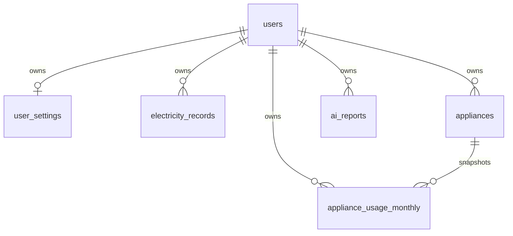

# PowerTrack: Core data model v1

วันที่ออกแบบ: 2026-10-07 | สถานะ: สร้างทั้ง 5 แท็บและ native tables ใน Google Sheets แล้ว ตรวจ header ตรง manifest

Google Spreadsheet เป้าหมาย: https://docs.google.com/spreadsheets/d/19AIuubmMQdYmT0XHY9xRg3fROLnmm0CBKS-0yZa2YTk/edit

## ขอบเขต

หนึ่งบัญชีมีหนึ่งบ้าน/ห้องพักใน v1 และมีเครื่องใช้หลายรายการ รายการหนึ่งอาจแทนเครื่องหลายเครื่องที่มีคุณสมบัติและเวลาใช้งานเหมือนกัน ถ้าเวลาใช้ต่างกันให้แยกเป็นคนละรายการ

คงแท็บ `users` และลำดับคอลัมน์เดิมทั้งหมด ไม่คัดลอกข้อมูลบัญชีลงตารางอื่น เพิ่ม 5 แท็บข้อมูล โดยแถวแรกเป็นชื่อคอลัมน์ภาษาอังกฤษตาม manifest `core-sheet-schema.json` ไม่มีชื่อเรื่อง แถวว่าง หรือ merged cells ก่อน header

ไฟล์ CSV ใน `sheet-headers/` มีเฉพาะ header ไม่มีข้อมูลผู้ใช้หรือข้อมูลตัวอย่างปะปนกับข้อมูลจริง

## ความสัมพันธ์



ทุกตารางใหม่มี `user_id` เป็น foreign key ไป `users.user_id` Backend กำหนดจาก authenticated current user และตรวจเจ้าของข้อมูลทุกครั้งที่อ่าน/เขียน ไม่มีการรับเจ้าของจาก browser

## 1. electricity_records: ข้อมูลค่าไฟจริงรายเดือน

หนึ่งแถวต่อผู้ใช้ต่อเดือน Unique: `(user_id, billing_month)`

| คอลัมน์ | ประเภท | ความหมาย |
|---|---|---|
| record_id | UUID | Primary key |
| user_id | UUID | เจ้าของข้อมูล |
| billing_month | Text YYYY-MM | เดือน ค.ศ. ของข้อมูล |
| previous_meter | Integer | มิเตอร์ครั้งก่อน >= 0 |
| current_meter | Integer | มิเตอร์ปัจจุบัน >= previous_meter |
| units_used | Integer | Backend: current_meter - previous_meter |
| unit_price | Decimal | บาท/kWh > 0 |
| service_charge | Decimal | บาท >= 0 |
| energy_cost | Decimal | Backend: units_used * unit_price ปัด 2 ตำแหน่ง |
| total_cost | Decimal | Backend: energy_cost + service_charge ปัด 2 ตำแหน่ง |
| created_at | ISO datetime | เวลาสร้าง |
| updated_at | ISO datetime | เวลาแก้ไข |

สูตร v1 เป็นราคาแบบคงที่ต่อหน่วยรวมค่าบริการ ยังไม่รวมการคำนวณภาษี Ft หรืออัตราก้าวหน้า การแก้ไข records ไม่ควรแก้ snapshot เครื่องใช้โดยอัตโนมัติ

## 2. appliances: รายการเครื่องใช้และค่าตั้งต้นปัจจุบัน

หนึ่งแถวต่อรายการเครื่องใช้ Primary key: `appliance_id` ไม่กำหนดชื่อเครื่องใช้เป็น unique

| คอลัมน์ | ประเภท | ความหมาย |
|---|---|---|
| appliance_id | UUID | Primary key |
| user_id | UUID | เจ้าของ |
| appliance_name | Text | ชื่อ เช่น แอร์ห้องนอน |
| category | Enum | air_conditioner, water_heater, computer, refrigerator, fan, lighting, washing_machine, television, other |
| brand | Text nullable | ยี่ห้อ |
| model | Text nullable | รุ่น |
| quantity | Integer | จำนวนเครื่อง >= 1 |
| rated_power_w | Decimal nullable | กำลังไฟบนฉลากต่อเครื่อง > 0 ไม่ใช่กำลังเฉลี่ยโดยอัตโนมัติ |
| average_power_w | Decimal nullable | กำลังเฉลี่ยที่ใช้ประมาณต่อเครื่อง > 0 |
| power_source | Enum | nameplate, measured, manufacturer, user_estimate, unknown |
| estimation_method | Enum | average_power หรือ monthly_kwh |
| default_hours_per_day | Decimal nullable | ชั่วโมงที่เปิดใช้ 0..24 |
| default_monthly_kwh_per_unit | Decimal nullable | kWh ต่อเครื่องต่อเดือน >= 0 |
| status | Enum | active หรือ archived |
| notes | Text nullable | สภาพ/ตำแหน่ง/ข้อสังเกตเกี่ยวกับเครื่องใช้ |
| created_at | ISO datetime | เวลาสร้าง |
| updated_at | ISO datetime | เวลาแก้ไข |

อนุญาตเก็บเครื่องใช้ที่ยังไม่รู้กำลังไฟ แต่ต้องระบุ unknown และไม่สร้างค่าประมาณขึ้นเอง เวลาตั้งต้นเป็นค่าช่วยกรอกฟอร์ม ไม่ใช่ประวัติการใช้งานที่ผ่านมา ไม่มี default_days_per_month เพราะจำนวนวันต้องขึ้นกับเดือนจริง

การเลิกใช้เครื่องให้เปลี่ยนเป็น archived ไม่ hard-delete ถ้ามีข้อมูลรายเดือนอ้างถึง

## 3. appliance_usage_monthly: snapshot เครื่องใช้และพฤติกรรมรายเดือน

หนึ่งแถวต่อเครื่องใช้ต่อเดือน Unique: `(user_id, appliance_id, billing_month)` สามารถบันทึกก่อนมีบิลของเดือนนั้นได้ จึงเชื่อมบิลด้วย user_id + billing_month แทนการบังคับ record_id

| คอลัมน์ | ประเภท | ความหมาย |
|---|---|---|
| usage_id | UUID | Primary key |
| user_id | UUID | เจ้าของ ต้องตรงกับ appliances.user_id |
| appliance_id | UUID | อ้างถึง appliances |
| billing_month | Text YYYY-MM | เดือน ค.ศ. |
| appliance_name_snapshot | Text | ชื่อ ณ เดือนนั้น |
| category_snapshot | Enum | ประเภท ณ เดือนนั้น |
| quantity_snapshot | Integer | จำนวน ณ เดือนนั้น >= 1 |
| rated_power_w_snapshot | Decimal nullable | กำลังตามฉลากต่อเครื่อง ณ เดือนนั้น |
| average_power_w_snapshot | Decimal nullable | กำลังเฉลี่ยต่อเครื่องที่ใช้คำนวณ |
| power_source_snapshot | Enum | แหล่งที่มาของกำลังไฟ |
| estimation_method | Enum | average_power หรือ monthly_kwh |
| hours_per_day | Decimal nullable | ชั่วโมงใช้งานต่อวัน 0..24 |
| days_used | Integer nullable | วันใช้ในเดือน 0..จำนวนวันจริงของเดือน |
| monthly_kwh_per_unit | Decimal nullable | kWh ต่อเครื่องในเดือนนี้ >= 0 |
| energy_source | Enum | measured, energy_label, manufacturer, user_estimate, unknown |
| estimated_kwh | Decimal nullable | ผลคำนวณรวมทุกเครื่อง Backend เท่านั้น |
| calculation_version | Text | เช่น energy-v1 |
| notes | Text nullable | บริบทเฉพาะเดือน เช่น ตั้งแอร์ 26 องศา |
| created_at | ISO datetime | เวลาสร้าง |
| updated_at | ISO datetime | เวลาแก้ไข |

Snapshot ทุกช่องถูกบันทึกจริงลงแถวของเดือน ไม่ใช้สูตร lookup แบบ live จาก appliances การเปลี่ยนชื่อ จำนวน หรือกำลังไฟของเครื่องในอนาคตจึงไม่เปลี่ยนประวัติ หากแก้ snapshot เดือนเดิม Backend ต้องคำนวณใหม่

### วิธีคำนวณ

- average_power: `(average_power_w_snapshot / 1000) * hours_per_day * days_used * quantity_snapshot`
- monthly_kwh: `monthly_kwh_per_unit * quantity_snapshot` ค่า kWh ต้องเป็นของเดือนเป้าหมาย ห้ามนำ kWh/ปีมาใส่ตรง ๆ โดยไม่แปลงและอธิบายสมมติฐาน
- ใช้ Decimal และปัด estimated_kwh เป็น 4 ตำแหน่ง ROUND_HALF_UP เก็บ calculation_version เพื่อย้อนตรวจได้
- ข้อมูลไม่ครบ -> estimated_kwh ว่าง ห้ามเปลี่ยนข้อมูลขาดเป็น 0; ชั่วโมง/วันที่ใช้เป็น 0 จริง -> ผลเป็น 0
- monthly_kwh ไม่คูณเวลา/จำนวนวันซ้ำ และไม่ใช้ rated_power_w เพื่อคำนวณโดยอัตโนมัติ
- ถ้าค่าจาก energy_label เป็นประมาณการตามเงื่อนไขทดสอบ ให้แสดงเป็นค่าประมาณ ไม่ใช่ข้อมูลวัดจริงของผู้ใช้

ตู้เย็น/แอร์ที่ทำงานเป็นรอบไม่ควรคูณกำลังสูงสุดบนฉลากกับชั่วโมงที่เปิดตรง ๆ กรณีไม่มีข้อมูลเฉลี่ยหรือ kWh ให้คงผล unavailable

## 4. user_settings: บริบทที่พักและค่าตั้งต้น

หนึ่งแถวต่อผู้ใช้ Primary key/unique: `user_id` ตารางนี้สร้างเมื่อผู้ใช้กรอกข้อมูล ไม่สมมติทุกคนว่ามีแถวอยู่แล้ว

| คอลัมน์ | ประเภท | ความหมาย |
|---|---|---|
| user_id | UUID | Primary key/เจ้าของ |
| residence_type | Enum | dormitory, apartment, house, other, unknown |
| occupants | Integer nullable | จำนวนผู้อาศัย >= 1 |
| default_unit_price | Decimal nullable | ราคาต่อหน่วยช่วยกรอก > 0 |
| default_service_charge | Decimal nullable | ค่าบริการช่วยกรอก >= 0 |
| monthly_budget | Decimal nullable | เป้าหมายค่าไฟบาท >= 0 |
| currency | Text | THB ใน v1 |
| timezone | Text | Asia/Bangkok ใน v1 |
| created_at | ISO datetime | เวลาสร้าง |
| updated_at | ISO datetime | เวลาแก้ไข |

การเปลี่ยนราคาตั้งต้นไม่เปลี่ยนราคาใน electricity_records เดิม ไม่ต้องสร้าง homes table สำหรับหนึ่งที่พัก/บัญชี แต่ถ้าขยายหลายที่พักภายหลังต้องเพิ่ม household_id และเปลี่ยน unique keys ไม่ควรผูกหลายบ้านกับ user_id อย่างเดียว

## 5. ai_reports: ผลวิเคราะห์ AI และหลักฐานที่ใช้

หนึ่งแถวต่อผลวิเคราะห์ที่สำเร็จ ผู้ใช้หนึ่งคนมีหลายผลในเดือนเดียวกันได้ Primary key: report_id ไม่มี unique user/month

| คอลัมน์ | ประเภท | ความหมาย |
|---|---|---|
| report_id | UUID | Primary key |
| user_id | UUID | เจ้าของ |
| billing_month | Text YYYY-MM | เดือนที่วิเคราะห์ |
| input_hash | Text | SHA-256 ของ canonical snapshot + versions |
| input_snapshot_json | JSON text | บิลย้อนหลัง การใช้เครื่อง และบริบทที่พักที่ใช้จริง |
| analysis_json | JSON text | ผลที่ผ่าน schema validation: summary, findings, recommendations, limitations |
| provider | Text | ผู้ให้บริการ AI ที่ใช้จริง |
| model | Text | model identifier ที่ใช้จริง |
| prompt_version | Text | เวอร์ชัน prompt |
| calculation_version | Text | เวอร์ชันการคำนวณ |
| created_at | ISO datetime | เวลาวิเคราะห์สำเร็จ |

Backend คำนวณสถิติ/การประมาณ/สถานการณ์ประหยัดก่อนส่งให้ AI อธิบาย ไม่ส่ง password_hash, phone, email, JWT, secrets หรือชื่อจริงไปใน snapshot เก็บเฉพาะบริบทการใช้ไฟที่จำเป็น

input_snapshot_json ต้องสำเนาข้อมูลที่ใช้จริง รวม record/usage IDs, ค่า, เดือน, updated_at และบริบท settings เพื่อให้การแก้ข้อมูลในอนาคตไม่เปลี่ยนหลักฐานของรายงานเก่า จำกัดแต่ละ JSON text <= 40000 characters โดยตรวจขนาดก่อนบันทึก ถ้าใหญ่กว่านั้นต้องลดช่วงประวัติที่ใช้พร้อมระบุช่วงอย่างชัดเจน หรือออกแบบ storage ใหม่ ห้ามตัด JSON ทิ้งกลางข้อความ

analysis_json โครงสร้างที่เตรียมไว้:

```json
{
  "summary": "ข้อความสรุป",
  "findings": [{"description": "ข้อค้นพบ", "evidence_ids": ["record/usage id"]}],
  "recommendations": [{"appliance_id": null, "action": "วิธีประหยัด", "reason": "เหตุผล", "estimated_savings_kwh": null, "estimated_savings_thb": null, "assumptions": []}],
  "limitations": ["ข้อจำกัดของข้อมูล"]
}
```

ค่า savings ต้องอ้างอิงสถานการณ์ที่ Backend คำนวณแล้วหรือเป็น null ห้ามใช้ตัวเลขที่ AI แต่งขึ้นเป็นผลยืนยัน ตรวจ appliance_id/evidence_ids ว่าอยู่ในข้อมูลของเจ้าของก่อนบันทึก

เมื่อข้อมูลเปลี่ยน ให้สร้างผลใหม่และเก็บผลเก่าไว้ แสดงผลเก่าว่าเป็นข้อมูล ณ เวลาสร้าง เปรียบเทียบ input_hash กับ snapshot ปัจจุบันเพื่อระบุ outdated อย่าถือว่ารายงานล่าสุดยังตรงข้อมูลเสมอ ต้องตรวจ records/usage ที่เพิ่มหรือลบด้วย ไม่ใช่เฉพาะ updated_at ของแถวเดิม

## กฎร่วมสำหรับ Google Sheets และ Backend

1. IDs/เดือน/ISO timestamps เป็น text; เดือน YYYY-MM เป็น ค.ศ. แสดง พ.ศ. เฉพาะ UI เงินใช้ Decimal ใน Backend และเขียนตัวเลขที่มี precision ตาม schema ด้วย RAW ไม่ใส่ comma/บาทในข้อมูล
2. เงินปัด 2 ตำแหน่ง ROUND_HALF_UP; unit_price และค่าพลังงาน/กำลังไฟรองรับทศนิยม 4 ตำแหน่ง Meter v1 เป็น integer
3. ช่อง optional ว่างหมายถึง unknown/null; 0 คือค่าศูนย์จริง Enum ห้ามใช้ค่าที่อยู่นอกชุด
4. created_at/updated_at เป็น ISO 8601 offset +07:00 จาก Backend ผู้ใช้ไม่แก้ IDs/เจ้าของ/ค่าคำนวณผ่าน API
5. Google Sheets ไม่มี foreign key/unique constraint จริง Backend ต้องตรวจสิทธิ์ ความสัมพันธ์ validation และ duplicate; ใช้ Redis lock ต่อ logical key สำหรับ create/upsert พร้อม token-safe release และป้องกัน lock หมดอายุขณะเขียน
6. ตรวจว่ามี users.user_id จริงสำหรับทุกแถวใหม่ และ appliance_id มีเจ้าของคนเดียวกับ usage ห้ามนำข้อมูลข้ามบัญชีมาคำนวณ/ส่ง AI
7. ข้อมูลค่าไฟกับ estimated_kwh ไม่จำเป็นต้องเท่ากัน ห้ามปรับค่าประมาณให้เท่ามิเตอร์อัตโนมัติหรือเรียกส่วนต่างว่าสาเหตุที่ยืนยันแล้ว ถ้าประมาณสูงกว่ามิเตอร์ให้แจ้งความไม่สอดคล้อง
8. เปรียบเทียบเดือนปฏิทินก่อนหน้า หากเดือนก่อนหายหรือ denominator=0 ให้เปอร์เซ็นต์ unavailable และบอกเหตุผล ค่าเฉลี่ยใช้เฉพาะเดือนมีข้อมูล ห้ามเติมเดือนขาดเป็น 0
9. Snapshot เครื่องใช้รายเดือนที่หายไปไม่แปลว่าเครื่องไม่มีหรือไม่ได้ใช้งาน ให้แจ้ง coverage ว่าไม่ครบและไม่ประมาณข้ามเดือนเอง
10. Dashboard/history/charts คำนวณจากตารางต้นทางผ่าน API ไม่ต้องเพิ่มตาราง summary ที่ซ้ำและเสี่ยง stale
11. ลบข้อมูลค่าไฟ/usage ไม่ลบเครื่องใช้ตามไปด้วย รายงานเก่าจะยังมี snapshot ให้ตรวจย้อนหลัง; การลบบัญชี/ข้อมูลทั้งหมดต้องมี flow ลบข้อมูลทุกตารางรวม ai_reports ที่ออกแบบชัดเจนก่อนเปิดฟังก์ชัน
12. การสร้างแท็บเป็น additive: ถ้าแท็บมีแล้วและ header ตรงให้ข้าม ถ้า header ไม่ตรงให้หยุดรายงาน mismatch ไม่ overwrite ข้อมูล users หรือแท็บเดิม

## การสร้างแท็บจริงและตรวจรับ

ต้องอ่านรายชื่อแท็บและ header users จาก Google Sheet จริงก่อน จากนั้นเพิ่มเฉพาะแท็บที่ยังไม่มีตาม manifest เขียน header แถว 1 freeze แถว 1 จัดความกว้างและ wrap header ไม่ใส่สูตรหรือ seed rows ในตาราง production

ตั้ง plain text ให้คอลัมน์ ID/month/timestamp/JSON และ number formats ให้คอลัมน์ตัวเลข ตามความหมายของข้อมูล เพิ่ม dropdown enums ถ้า connector รองรับ แต่ validation ใน Sheets ไม่ทดแทน Backend

อ่านชื่อแท็บและ header กลับมาเทียบ manifest ทุกคอลัมน์ และตรวจว่า users header/data ไม่เปลี่ยนก่อนรายงานว่าสร้างสำเร็จ

สถานะปัจจุบัน: สร้างและอ่านตรวจแท็บจริงผ่าน Google Drive แล้ว ทั้ง 5 ตารางยังไม่มีข้อมูลจริงหรือ seed records ตรวจ header users A1:L1 ว่าไม่เปลี่ยน และไม่มี write request ไป users ตรวจการแสดงผลทุกแท็บผ่าน Google Sheets ที่ zoom 100%

| แท็บ | sheetId | native tableId | header range |
|---|---|---|---|
| electricity_records | 10701 | 2040907600 | A1:L1 |
| appliances | 10702 | 1930960172 | A1:Q1 |
| appliance_usage_monthly | 10703 | 1637338117 | A1:T1 |
| user_settings | 10704 | 1372279214 | A1:J1 |
| ai_reports | 10705 | 2053708355 | A1:K1 |

Native table ปัจจุบันครอบคลุม header และแถวว่าง 1 แถว ไม่ใช่ 1000 records; grid เตรียม 1000 แถว ขณะเชื่อม Backend ต้องตรวจและขยาย table range ให้ครอบคลุมแถวข้อมูลที่ append โดยไม่ถือว่า API append ขยาย table metadata อัตโนมัติ คงรูปแบบและ dropdown ของ table เมื่อเพิ่มแถว ทศนิยมเงิน 2 ตำแหน่ง อัตรา/พลังงาน 4 ตำแหน่ง ID/month/timestamps เป็น text

Unique keys, foreign keys, snapshot creation, calculations และ AI validation ยังเป็นข้อกำหนดในแบบข้อมูล ไม่ได้เกิดขึ้นอัตโนมัติจากการสร้างตาราง ยังต้อง implement ใน Backend
