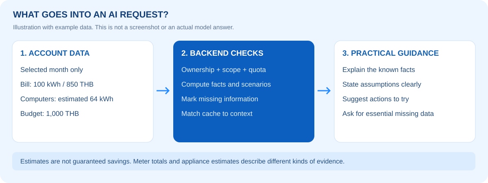

# คู่มือใช้งาน PowerTrack ⚡

[← กลับ README](../README.md) · [เปิดระบบ](https://powertrack-demo.onrender.com/login)

คู่มือสำหรับเพื่อนในกลุ่ม ผู้ทดลอง และอาจารย์ ตัวเลขด้านล่างเป็นข้อมูลจำลองเพื่ออธิบาย ไม่ใช่ผลวิเคราะห์ของบัญชีจริง

## สารบัญ

1. [เข้าสู่ระบบ](#login)
2. [ตั้งค่าที่พักและงบ](#settings)
3. [เพิ่มบิลค่าไฟ](#electricity)
4. [ดู แก้ไข และลบประวัติ](#history)
5. [เพิ่มเครื่องใช้และการใช้งาน](#appliances)
6. [อ่านหน้าหลักและกราฟ](#analysis)
7. [ถาม AI และถามต่อ](#advice)
8. [สร้างพร้อมท์ไปถาม AI ภายนอก](#export)
9. [บันทึกและเปิดรายงาน](#reports)
10. [ลำดับนำเสนอหน้าชั้นเรียน](#demo-script)
11. [แก้ปัญหาระหว่างใช้งาน](#troubleshooting)


<a id="login"></a>
## 1. เข้าสู่ระบบ

1. เปิด https://powertrack-demo.onrender.com/login
2. หากมีบัญชีแล้ว กรอกข้อมูลเข้าสู่ระบบตามฟอร์ม หากยังไม่มีให้เลือกสมัครสมาชิก กรอกช่องที่กำหนด แล้วเข้าสู่ระบบ
3. หรือกดเข้าสู่ระบบด้วย Google แล้วเลือกบัญชีที่ต้องการ
4. เมื่อเข้าสำเร็จ ใช้เมนูด้านข้างสลับหน้าหลัก เพิ่มค่าไฟ ประวัติ เครื่องใช้ วิเคราะห์ กราฟ คำแนะนำ และตั้งค่า

แต่ละบัญชีมีข้อมูลแยกกัน ให้ใช้คนละบัญชีเมื่อต้องการทดสอบการแยกข้อมูล หากเว็บ Free เพิ่งเริ่มทำงานหลัง idle ให้รอโหลดเสร็จ และเข้าสู่ระบบใหม่เมื่อ session หมดอายุ

## เตรียมข้อมูลก่อนใช้งาน

เตรียมเดือนของบิล เลขมิเตอร์ครั้งก่อน/ปัจจุบัน ราคา/หน่วย ค่าบริการ และรายการเครื่องใช้ที่ต้องการประเมิน ข้อมูลที่ไม่ทราบให้เว้นในช่องไม่บังคับ ไม่กรอกตัวเลขสมมติเสมือนเป็นค่าที่วัดจริง

<a id="settings"></a>
## 2. ตั้งค่าที่พักและงบประมาณ

เปิด **ตั้งค่า** แล้วรอโหลดค่าปัจจุบันก่อนแก้ไข

| ช่อง | ตัวอย่าง | ความหมาย |
|---|---|---|
| ประเภทที่พัก | หอพัก | เลือกตามที่อยู่อาศัย |
| จำนวนผู้อาศัย | 2 คน | จำนวนคนจริง ไม่บังคับ |
| ค่าไฟต่อหน่วย | 8 บาท/kWh | ใช้ราคาในบิล/ข้อตกลงที่พัก เมื่อทราบ |
| ค่าบริการตั้งต้น | 50 บาท | ค่าบริการที่ทราบ |
| งบค่าไฟต่อเดือน | 1,000 บาท | เป้าหมายการใช้จ่าย ไม่ใช่ยอดบิลจริง |

กด **บันทึกการตั้งค่า** แล้วตรวจสรุปการตั้งค่า ข้อมูลนี้เป็นบริบทให้ส่วนอื่นและ AI ไม่แก้บิลย้อนหลังอัตโนมัติ ก่อนบันทึกบิลใหม่ให้ตรวจค่าที่ปรากฏในฟอร์มด้วย

<a id="electricity"></a>
## 3. เพิ่มบิลค่าไฟ

เปิด **เพิ่มข้อมูลค่าไฟ** เลือกเดือน แล้วกรอกข้อมูลของเดือนนั้น ตัวอย่าง:

| ช่อง | ค่า |
|---|---:|
| เลขมิเตอร์ครั้งก่อน | 100 |
| เลขมิเตอร์ปัจจุบัน | 200 |
| ค่าไฟต่อหน่วย | 8 บาท |
| ค่าบริการ | 50 บาท |

กด **คำนวณและบันทึก** รอข้อความสำเร็จ แล้วตรวจผล:

```text
หน่วยไฟ       = 200 − 100  = 100 kWh
ค่าไฟ         = 100 × 8    = 800 บาท
ค่าใช้จ่ายรวม = 800 + 50   = 850 บาท
```


*ภาพจากการทดสอบด้วยบัญชีจำลอง เมนูบางตำแหน่งอาจต่างจากรุ่นออนไลน์*

หนึ่งบัญชีบันทึกได้หนึ่งบิลต่อเดือน หากมีแล้วให้แก้ในประวัติ เลขมิเตอร์ปัจจุบันต้องไม่น้อยกว่าครั้งก่อน สูตรใช้ราคาคงที่ ไม่คำนวณขั้นบันได Ft หรือภาษีอัตโนมัติ

<a id="history"></a>
## 4. ดู แก้ไข และลบประวัติ

1. เปิด **ประวัติข้อมูล** รอรายการโหลด
2. พิมพ์เดือน/ปีในช่องค้นหา หรือเลือกปี ใช้ปุ่มแบ่งหน้าเพื่อดูรายการอื่น
3. ตรวจหน่วย ค่าไฟ ค่าบริการ ยอดรวม และเปอร์เซ็นต์เปรียบเทียบ
4. หากกรอกผิด เลือก **แก้ไข** ของบิลนั้น ปรับข้อมูล ตรวจผลคำนวณ แล้วบันทึก
5. หากไม่ต้องการบิล เลือก **ลบ** ตรวจเดือนในกล่องยืนยัน แล้วกดยืนยันเฉพาะเมื่อแน่ใจ

เปอร์เซ็นต์เทียบ **ค่าใช้จ่ายรวมกับเดือนปฏิทินก่อนหน้า** ไม่ใช่แถวก่อนหน้าในหน้าค้นหา:

```text
% เปลี่ยนแปลง = (ยอดเดือนนี้ − ยอดเดือนก่อน) ÷ ยอดเดือนก่อน × 100
```

ถ้าขาดเดือนก่อนหรือยอดเดิมเป็นศูนย์ จะแสดง `–` หลังแก้/ลบให้กลับหน้าหลักหรือวิเคราะห์และโหลดข้อมูลใหม่เพื่อตรวจผล ใช้บิลจำลองเมื่อต้องสาธิตการลบ

<a id="appliances"></a>
## 5. เพิ่มเครื่องใช้ไฟฟ้าและการใช้งาน

เปิด **เครื่องใช้ไฟฟ้า** แล้วเลือกเดือนให้ตรงกับบิลที่จะวิเคราะห์

### ข้อมูลพื้นฐาน

- กรอกชื่อ ประเภท และจำนวนเครื่องตามช่องบังคับ
- หากเลือก **อื่น ๆ** ให้ระบุประเภท เช่น เครื่องเย็บผ้า
- ยี่ห้อ รุ่น กำลังไฟตามฉลาก และหมายเหตุ กรอกเมื่อทราบ ช่องไม่บังคับเว้นได้
- หากเครื่องสองเครื่องมีพฤติกรรมใช้งานต่างกัน ให้แยกคนละรายการ

### วิธี A: กำลังไฟเฉลี่ย × เวลา

กรอก W เฉลี่ยต่อเครื่อง ชั่วโมง/วัน และวันใช้งานในเดือนนั้น ตัวอย่างคอมพิวเตอร์:

| ข้อมูล | ค่า |
|---|---:|
| จำนวน | 2 เครื่อง |
| กำลังไฟเฉลี่ยต่อเครื่อง | 200 W |
| เวลา | 8 ชั่วโมง/วัน |
| วันใช้งาน | 20 วัน |

```text
พลังงาน = (200 ÷ 1,000) × 8 × 20 × 2 = 64 kWh/เดือน
```

### วิธี B: หน่วยไฟต่อเดือน (kWh)

ใช้เมื่อมีหน่วยไฟรายเดือนจากการวัดหรือข้อมูลที่เชื่อถือได้ ช่องนี้เป็น **kWh ต่อเครื่องในเดือนนั้น** เช่น 35 kWh × 2 เครื่อง = 70 kWh ทั้งรายการ อย่าใส่ยอดรวมทุกเครื่องแล้วคูณจำนวนซ้ำ

เลือกแหล่งที่มาตามจริง กด **บันทึกเครื่องใช้และการใช้งาน** แล้วตรวจรายการของเดือนและสรุปด้านบน W คือกำลังไฟ ส่วน kWh คือพลังงาน เป็นคนละหน่วยกัน

แอร์และตู้เย็นทำงานเป็นรอบ ไม่ใช้ W สูงสุดคูณชั่วโมงทั้งวันแทนกำลังเฉลี่ย หากไม่ทราบข้อมูลประมาณการ ให้ระบุเท่าที่ทราบ ระบบแยกรายการที่ยังประเมินไม่ได้ ไม่ถือว่ารายการนั้นใช้ไฟเป็นศูนย์

### แก้ไขหรือยกเลิก

กด **แก้ไข** เพื่อโหลดข้อมูลกลับฟอร์ม ปรับแล้วบันทึก หากเลือก **ยกเลิกรายการ** ระบบถามยืนยันและนำออกจากรายการใช้งาน แต่เก็บแถวประวัติเป็น `cancelled` ต่างจากการลบบิลค่าไฟ

<a id="analysis"></a>
## 6. อ่านหน้าหลักและกราฟ

**หน้าหลัก:** ตรวจสรุปบิล แนวโน้มค่าใช้จ่ายย้อนหลัง และสัดส่วนค่าใช้จ่าย กราฟช่วยสังเกตแนวโน้ม ไม่พิสูจน์สาเหตุว่าเกิดจากเครื่องใดโดยลำพัง

**วิเคราะห์ข้อมูล:** เลือกเดือนสิ้นสุดและช่วง 3 / 6 / 12 เดือน สลับ **สรุปข้อมูล** กับ **กราฟ** และเลือกหน่วยไฟหรือค่าใช้จ่ายตามตัวเลือกในหน้า

- ยอดบิล/มิเตอร์เป็นข้อมูลที่บันทึกจริง ส่วนพลังงานรายเครื่องเป็นค่าประมาณ
- สัดส่วนค่าไฟและค่าบริการไม่ใช่สัดส่วนพลังงานรายเครื่อง
- ถ้าเครื่องใช้รวมสูงกว่ามิเตอร์ ให้ตรวจ W จำนวน ชั่วโมง และวันก่อนสรุป
- ถ้ารวมต่ำกว่ามิเตอร์ อาจบันทึกไม่ครบหรือค่าประมาณไม่ตรง อย่าวินิจฉัยว่าไฟรั่วจากส่วนต่างเพียงอย่างเดียว
- เดือนที่ไม่มีข้อมูลไม่ได้แปลว่าไม่ใช้ไฟ

<a id="advice"></a>
## 7. ถาม AI และถามต่อ



1. เปิด **คำแนะนำ AI** หรือแถบคำแนะนำจากหน้าวิเคราะห์
2. เลือก **เดือนที่วิเคราะห์** รอโหลดบริบทและโควตา
3. กดหัวข้อแนะนำ หรือพิมพ์คำถามแล้วส่ง
4. อ่านทั้งตัวเลข เหตุผล สมมติฐาน และข้อมูลที่ยังขาด
5. ถามต่อในบทสนทนาเดิมเพื่อเจาะรายละเอียด หากต้องการเริ่มเรื่องใหม่ให้กด **เริ่มใหม่** และตรวจเดือนอีกครั้ง

| เป้าหมาย | ตัวอย่างคำถาม |
|---|---|
| ภาพรวม | ช่วยสรุปค่าไฟเดือนนี้และจุดที่ควรเริ่มประหยัด |
| เจาะจง | คอมพิวเตอร์ที่บันทึกใช้ไฟกี่หน่วย แสดงสูตรด้วย |
| วางแผน | ถ้าต้องการให้อยู่ในงบ ควรปรับอะไรและต้องมีข้อมูลเพิ่มอะไร? |
| ขอรายละเอียด | อธิบายข้อแรกเป็นขั้นตอนให้ทำตามภายในหนึ่งสัปดาห์ |
| ถามต่อ | ถ้าลดเวลาเครื่องนั้นวันละหนึ่งชั่วโมง จะเปลี่ยนแปลงเท่าไรตามข้อมูลที่มี? |

AI ใช้ข้อมูลที่มีและอาจขอเพิ่ม ไม่รับประกันยอดประหยัด หากเดือนนั้นไม่มีข้อมูล ระบบจะแจ้งข้อจำกัด ไม่แต่งบิลหรือเครื่องใช้ขึ้นเอง

โควตา **5 ครั้งต่อบัญชีในช่วงย้อนหลัง 1 ชั่วโมง** รวม cache คำถามที่ถูกนับทยอยพ้นช่วงของตนเอง ไม่จำเป็นต้องคืนพร้อมกันทั้งห้าครั้ง คำขอที่รับแล้วอาจนับแม้ AI ไม่สำเร็จ เริ่มใหม่/refresh ไม่ล้างโควตาที่ยังอยู่ใน Redis

<a id="export"></a>
## 8. สร้างพร้อมท์ไปถาม AI ภายนอก

ใช้ได้แม้แชตหมดโควตา จำกัดการสร้าง **5 ครั้งต่อนาทีต่อบัญชี**

1. ตรวจเดือน แล้วกด **สร้างพร้อมท์สำหรับคัดลอก ↗**
2. ตรวจบิล เครื่องใช้ งบ และข้อมูลที่ขาดในหน้าต่างตัวอย่าง
3. กด **คัดลอกพร้อมท์** แล้วนำไปวางและส่งใน ChatGPT, Gemini หรือ AI ที่เลือกเอง
4. หากแก้ข้อมูลต้นทาง ให้สร้างพร้อมท์ใหม่จากข้อมูลล่าสุด

ไม่เรียก Gemini และไม่ใช้โควตาแชตของระบบ ข้อมูลยังไม่ถูกส่งไป AI ภายนอกจนกว่าคุณจะนำไปวาง/ส่งเอง ตรวจข้อมูลก่อนแชร์ คำตอบจากบริการภายนอกไม่ถูกนำกลับมาเก็บใน PowerTrack อัตโนมัติ

<a id="reports"></a>
## 9. บันทึกและเปิดรายงาน

1. ใต้คำตอบที่มีปุ่ม ให้กด **บันทึกผลวิเคราะห์** เมื่อเห็นว่ามีประโยชน์
2. รอข้อความบันทึกสำเร็จ ไม่จำเป็นต้องบันทึกทุกข้อความ
3. กด **รายงานที่บันทึกไว้** กรองเดือน/เลือกทุกเดือน และแบ่งหน้าเพื่อหารายงาน
4. เปิดรายละเอียดเพื่อตรวจคำตอบและสำเนาข้อมูล ณ เวลาวิเคราะห์

รายงานเก่าไม่อัปเดตตามบิลที่แก้ภายหลัง หากต้องการคำแนะนำจากข้อมูลใหม่ ให้โหลดบริบทล่าสุดและถามใหม่

<a id="demo-script"></a>
## 10. ลำดับนำเสนอหน้าชั้นเรียน 5–7 นาที

| ลำดับ | สิ่งที่สาธิต | ประเด็นอธิบาย |
|---|---|---|
| 1 | Login และหน้าหลัก | แต่ละบัญชีมีข้อมูลของตัวเอง |
| 2 | ตั้งค่าที่พัก จำนวนคน และงบ | บริบทสำหรับวิเคราะห์ |
| 3 | บิลตัวอย่าง 100→200 ราคา 8 ค่าบริการ 50 | Backend คำนวณ 100 kWh รวม 850 บาท |
| 4 | คอมพิวเตอร์ตัวอย่าง 64 kWh | พลังงานประมาณมีสูตรและแหล่งที่มา |
| 5 | ประวัติและกราฟ | ดูแนวโน้มและเทียบเดือนปฏิทิน |
| 6 | ถาม AI หนึ่งคำถามและถามต่อ | ใช้ข้อมูลเดือนที่เลือก มีสมมติฐาน |
| 7 | บันทึกรายงานและเปิดพร้อมท์ | เก็บคำตอบที่เลือกและใช้งานต่อเมื่อหมดโควตา |

เปิดเว็บล่วงหน้า ตรวจ Google login และโควตาก่อนเริ่ม เตรียมสองเดือนติดกันถ้าต้องโชว์เปอร์เซ็นต์ ใช้เดือนว่างในบัญชีสาธิตสำหรับเพิ่มบิล ไม่แก้ข้อมูลจริงของผู้อื่น

<a id="troubleshooting"></a>
## 11. แก้ปัญหาระหว่างใช้งาน

| อาการ | สิ่งที่ทำได้ |
|---|---|
| เปิดเว็บครั้งแรกนาน | รอ Free service เริ่มทำงาน แล้วลองใหม่หากยังไม่สำเร็จ |
| ต้อง login ใหม่ | session อาจหมดอายุหรือ Redis restart |
| ไม่พบรายการ | ตรวจเดือน ปี ตัวกรอง และบัญชี |
| บิลเดือนเดิมซ้ำ | แก้รายการเดิมในประวัติ |
| เครื่องใช้บันทึกไม่ได้ | ตรวจจำนวน >= 1 ชั่วโมง <= 24 วันไม่เกินจำนวนวันของเดือน และช่องบังคับของวิธีที่เลือก |
| AI หมดโควตา | รอตามเวลาที่แสดง หรือสร้างพร้อมท์ไปถามภายนอก |
| คัดลอกไม่ได้ | เลือกข้อความในกล่องแล้วคัดลอกด้วยตนเอง |
| โหลดไม่สำเร็จ | รอแล้วลองใหม่ ตรวจรายการก่อนกดบันทึกซ้ำ |
| Google redirect_uri_mismatch | ผู้ดูแลตรวจ callback ใน Render และ Google Cloud ให้ตรงกัน |
| Google ไม่อนุญาตผู้ทดลอง | ผู้ดูแลตรวจ OAuth Test users หาก project อยู่ Testing |

Free Key Value ไม่ persistent เมื่อ restart อาจต้อง login ใหม่และโควตาเริ่มใหม่ ข้อมูลหลักใน Sheets ยังอยู่ หากแจ้งปัญหา ให้ส่งชื่อหน้า เดือน เวลา และข้อความผิดพลาด ไม่ส่งรหัสผ่าน API key, token หรือ service-account key

[กลับ README](../README.md) · [คู่มือผู้ดูแล](render-deploy.md)
